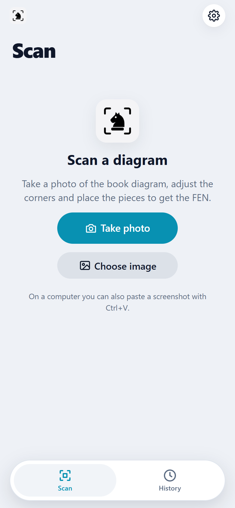
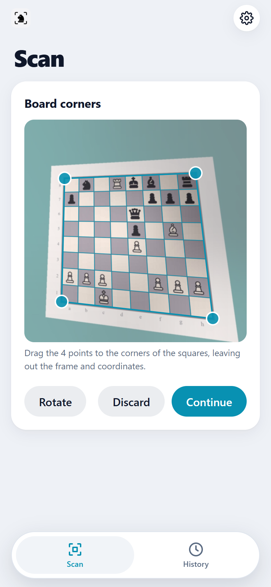
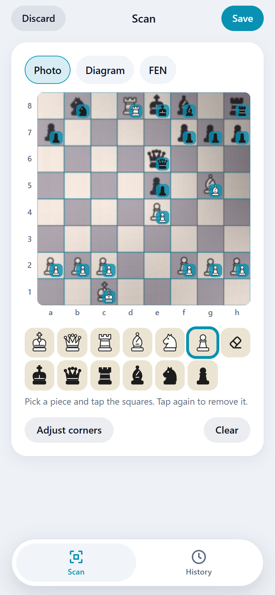
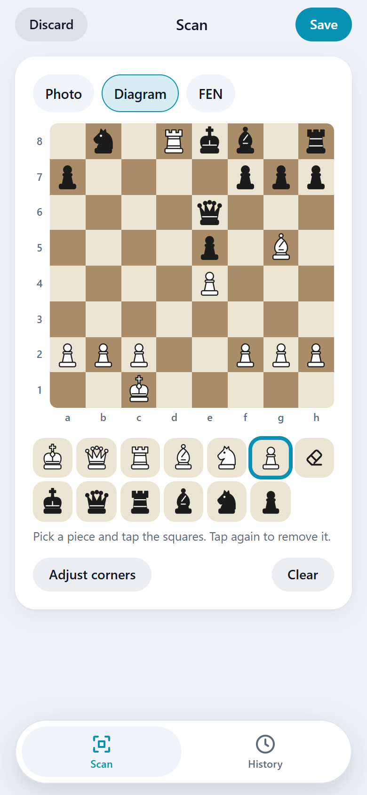
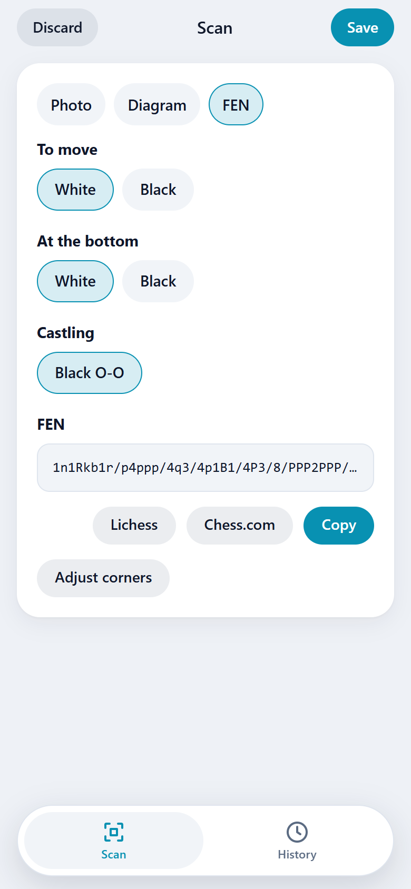
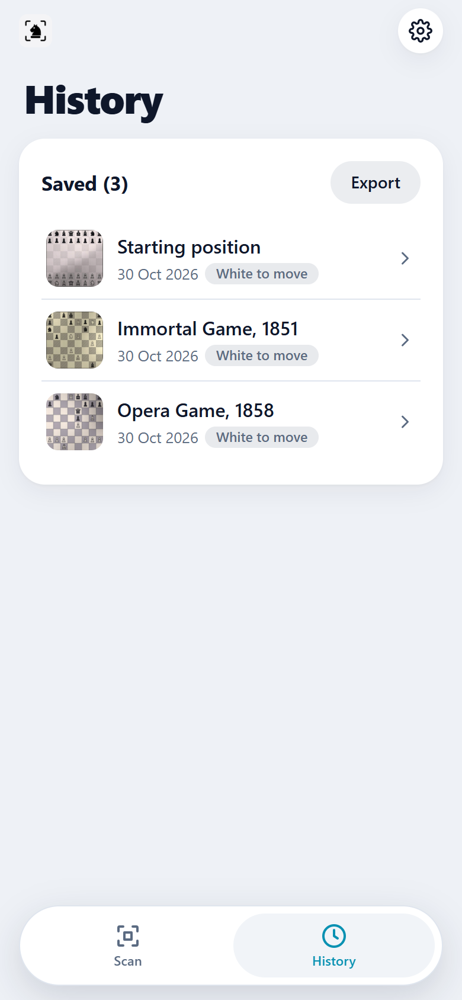
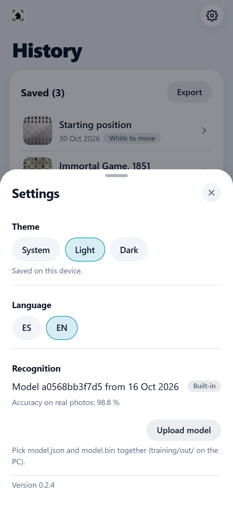

<p align="center">
  
</p>

<h1 align="center">Chess Scanner</h1>

<p align="center">
  Turn a photo of a <b>chess diagram from a book</b> into its <b>FEN</b>, ready to copy or open in Lichess and Chess.com.<br>
  A small self-hosted web app for your <b>Asustor NAS</b> or any computer on your network.
</p>

---

## Features

| | |
| :--- | :--- |
| **Scan** | Take a photo with the phone camera, choose an image, or paste a screenshot (Ctrl+V) on a computer. |
| **Corners** | Drag four points onto the board corners; the photo is straightened with a perspective transform. |
| **Recognition** | A small neural network runs in the browser and proposes the position, marking uncertain squares for review. |
| **Editor** | Fix any square with the piece palette. Photo and clean diagram views. |
| **FEN** | Side to move, orientation (the app guesses when Black is at the bottom) and castling rights. Copy, or open in Lichess or Chess.com. |
| **History** | Saved scans with their images, reopen and correct later. |
| **Dataset** | Export every saved scan as a ZIP to retrain the model on a PC, then upload the new model from Settings. |

Works on phone and desktop, in English and Spanish, with light and dark themes. Can be added to the home screen.

## Screenshots

<table>
  <tr>
    <td align="center"><br>Scan</td>
    <td align="center"><br>Board corners</td>
    <td align="center"><br>Recognized position</td>
  </tr>
  <tr>
    <td align="center"><br>Diagram editor</td>
    <td align="center"><br>FEN</td>
    <td align="center"><br>History</td>
  </tr>
  <tr>
    <td align="center"><br>Settings</td>
    <td></td>
    <td></td>
  </tr>
</table>

The sample diagrams are synthetic renders of public-domain games (Opera Game, 1858; Immortal Game, 1851).

## Requirements

- One of:
  - **Asustor NAS** with ADM 3.x and **Entware** (from App Central). Runs on an AS-202TE (32-bit, 1 GB RAM).
  - **Any computer** with Python 3.11 or newer (Windows, macOS, Linux).
- A modern browser on the phone or computer used to scan. Recognition runs in the browser, not on the server.

## Installation

### On the NAS

1. Build the package (see [Packaging](#packaging)) or download a release `.apk`.
2. In ADM, go to **App Central → Management → Manual Install** and upload `chess-scanner_<version>_any.apk`.
   The installer sets up Python 3 from Entware and the app's dependencies in a virtual environment.
3. Open `http://<NAS_IP>:8091`, or launch **Chess Scanner** from the ADM desktop.

Upgrades keep your data. Uninstalling backs up the database and images to
`/volume1/home/chess-scanner-backup/<date>/`.

### On a Windows computer

Install [Python](https://www.python.org/downloads/windows/) 3.11 or newer, then from the repository root in
PowerShell:

```powershell
py -3.13 -m venv .venv
.\.venv\Scripts\python -m pip install -r package\requirements.txt
cd package
..\.venv\Scripts\python -m app.main
```

Open `http://localhost:8091`, or `http://<COMPUTER_IP>:8091` from a phone on the same network.
Stop the app with Ctrl+C. To start it again later:

```powershell
cd package
..\.venv\Scripts\python -m app.main
```

- Name the Python version (`py -0` lists them). `py -3` may pick a free-threaded build (`3.13t`), which does
  not work.
- Allow Python through the Windows firewall (private networks) to reach the app from other devices.
- If the repository folder is moved or renamed, recreate the venv with `py -3.13 -m venv --clear .venv`.
- On Linux or macOS, use `python3 -m venv .venv` and `.venv/bin/python`.

## Getting started

1. **Scan → Take photo** (or **Choose image**, or paste a screenshot with Ctrl+V on a computer).
2. Drag the four points to the corners of the squares, leaving out the frame and coordinates. The projected
   grid helps to line them up. Tap **Continue**.
3. Review the proposed position; uncertain squares are highlighted. To fix a square, pick a piece in the
   palette and tap it (tap again to clear).
4. Open **FEN**, check the side to move, which color is at the bottom and castling rights, then **Copy** or
   open it in **Lichess** or **Chess.com**.
5. **Save** keeps the scan in **History**.

> [!NOTE]
> Over plain HTTP the browser does not allow live camera access, so **Take photo** uses the phone's file
> picker, which opens the camera app.

## Improving recognition

Every saved and corrected scan is a labeled example. **History → Export** downloads a ZIP with the images,
labels and the model's original guesses. The [training](training/README.md) folder turns it into a new model
on a PC (PyTorch, CPU is enough). Upload `model.json` and `model.bin` from
**Settings → Recognition → Upload model**; no repackaging is needed, and **Back to built-in** restores the
original model.

## Configuration

Override any default from [`config.default.yaml`](package/config/config.default.yaml) in
`package/config/config.yaml`, which survives upgrades:

```yaml
app:
  host: "0.0.0.0"
  port: 8091
```

App data (`app.db`, `scans/` and uploaded `models/`) is stored in `package/data/`, or in the folder set by the
`APP_DATA_DIR` environment variable.

## Security

There is **no login**: anyone who can reach port 8091 can view, change and delete scans and replace the model.

> [!WARNING]
> Keep it on your local network. Do not expose or forward port 8091.

Report vulnerabilities by opening an issue.

## Development

```powershell
cd package
..\.venv\Scripts\python -m uvicorn app.main:app --reload --port 8091   # run with auto-reload
..\.venv\Scripts\python -m unittest discover -s tests -t .              # run the tests
```

Python 3.11 matches the NAS. The NAS (32-bit i686, 1 GB RAM) sets these rules:

- **Dependencies:** FastAPI `<0.100`, Pydantic v1, `httpx<0.28`. Pure-Python packages or ones with a
  `manylinux*_i686` wheel only.
- **Front end:** one `index.html`, `app.css`, vanilla `app.js` and `vision.js` (image warping and the neural
  network). No Node, bundlers, CDNs, web fonts or service workers.
- **Scripts:** `CONTROL/*.sh` run under BusyBox `/bin/sh` with LF line endings.

```
CONTROL/              ADM package metadata and install/start scripts
package/
├── app/
│   ├── api/          HTTP routes (scans, model)
│   ├── services/     Scan storage and model management
│   ├── models/       Database tables
│   ├── model/        Built-in recognition model
│   └── static/       Front end
├── config/           Default configuration
└── tests/            Test suite
training/             Synthetic data generator and model training (PC only)
tools/                Icon generator
build_package.py      Builds the .apk
```

## Packaging

```powershell
python build_package.py -m "What changed"   # bump the patch version and build
python build_package.py --bump minor        # or: --bump major, --version X.Y.Z, --no-bump
```

Output goes to `dist/chess-scanner_<version>_any.apk` (`build.bat` does the same on Windows). To regenerate
the icons from `assets/icon-source.png`, run `python tools/make_icons.py` (needs Pillow).

## License

Released under the [MIT License](LICENSE).

Not affiliated with Lichess, Chess.com or Asustor.
